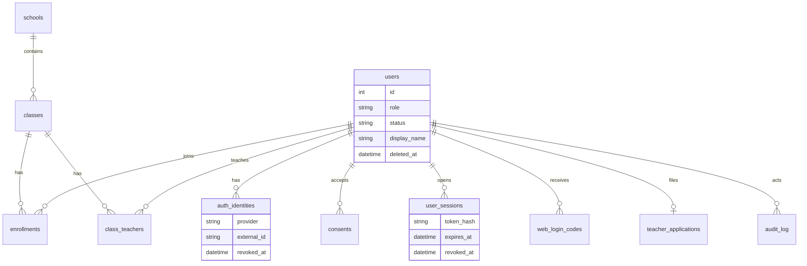

# Аккаунты

Вход только через базу. В памяти процесса пользователей нет.

`user.id` из мини-приложения и `user_id` из апдейта бота **не считаются одним числом**, пока это не подтверждено живой парой. Привязка мини-приложения кодом описана ниже и в код не внесена: её нужно подтвердить до реализации.

## Откуда взяты поля

Проверено 2026-10-30:

- Бот, OpenAPI `schema.yaml` репозитория `max-messenger/api-schema`, объект `User`: поле `user_id`, описание «Users identifier», int64. Так же уходит `bot_started.user` и `message.sender`.
- Мини-приложение, `dev.max.ru/docs/webapps/validation` и `dev.max.ru/docs/webapps/bridge`: в `initData` объект `user` с полем `id` (в примере `67890`).
- Ни на одной из этих страниц нет фразы, что `user.id` и `user_id` — одно и то же значение. Имена полей разные.

Поэтому `POST /api/session` ищет только `auth_identities.provider = max_webapp`. Строк с таким провайдером код не создаёт. Кабинет учителя в браузере открывается кодом из бота и от этого равенства не зависит.

## start_param

В Bridge и в `initData` поле `start_param` есть. Его даёт ссылка `https://max.ru/<бот>?startapp=<payload>` и кнопка `open_app` с `payload`. Сервер видит его только внутри проверенного `initData`, не из `initDataUnsafe`.

Как привязать кабинет без ручного кода, когда числа `user.id` и `user_id` ещё не сверены:

1. Бот создаёт одноразовый билет на 5 минут и кладёт в кнопку `open_app` payload из букв, цифр, `_` и `-` (до 512 знаков).
2. MAX открывает мини-приложение. В `initData` приходит `start_param` = этот payload.
3. Сервер проверяет подпись `initData`, находит билет по хэшу и в одной транзакции пишет `auth_identities(provider=max_webapp, external_id=user.id)` на того пользователя, которому выдан билет.
4. Билет гасится. Повтор не создаёт вторую привязку: мешает `unique(provider, external_id)`.

Это описание, не включённый код. Сначала живая сверка `/whoami` и `/dev/whoami`.

## Привязка мини-приложения, ещё не сделана

1. Ученик или учитель уже есть в боте: `provider=max`, `external_id` = `user_id` из апдейта.
2. Мини-приложение присылает проверенный `initData`. Сервер читает `user.id` и не находит `max_webapp`.
3. Бот по кнопке «Привязать кабинет» присылает код на 5 минут.
4. Мини-приложение отправляет код и `initData` одним запросом. В одной транзакции пишется `auth_identities(provider=max_webapp, external_id=user.id, user_id=тот же человек)`.
5. Повтор и гонка упираются в `unique(provider, external_id)`.

Если позже на одном живом аккаунте числа совпадут, этот шаг можно заменить копированием идентификатора. До этой проверки копировать его нельзя.

## Схема

`signup_hints` хранит ключ класса до согласия и пользователем не является.

## Сценарии

Ученик:

1. Нажимает старт в MAX. Бота ещё нет в `users`.
2. Бот просит согласие. До кнопки «Согласен» строка не создаётся, текст вопроса не пишется.
3. «Согласен» создаёт `users` и `auth_identities(provider=max)` в одной транзакции. Повтор не создаёт вторую строку.
4. Если ссылка была `https://max.ru/<бот>?start=<join_key>`, после согласия ученик попадает в класс. Без ключа тренировка есть, на карте класса его нет.
5. Код класса можно прислать сообщением (`8BDEMO` у демо-класса).

Учитель:

1. Тот же вход и согласие. Роль пока `student`.
2. Пишет «Я учитель», затем ФИО и школу. Заявка `pending`. Кабинета нет.
3. Админ выполняет `python -m app.admin approve <id>` или учитель присылает код `T######` из `python -m app.admin invite`.
4. Роль становится `teacher`. «Войти в кабинет» присылает 6 цифр на 5 минут, не больше 5 кодов в час.
5. На странице `/cabinet` код меняется на cookie. Сессия 12 часов простоя, не дольше 7 дней, продлевается при заходе. «Выйти на всех устройствах» — `POST /api/logout-all`.

Админ:

1. Идентификатор MAX указан в `ADMIN_MAX_IDS` до первого согласия: роль `admin`.
2. Дальше консоль: `users`, `schools`, `audit`, `approve`, `block`, `unblock`, `close`, `delete --yes`, `invite`, `transfer`, `add-school`, `add-class`.
3. `block` закрывает бота и API, строки остаются. `close` — мягкое удаление. `delete --yes` стирает ответы, занятия и вход. В `audit_log` остаётся факт без имени.
4. `transfer` печатает `P######`. Его вводят с нового аккаунта MAX. Старая привязка получает `revoked_at`, история остаётся на старом `users.id`.

Ученик в браузер по коду не входит.
